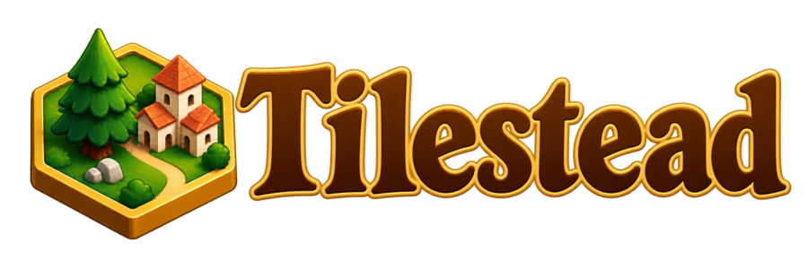
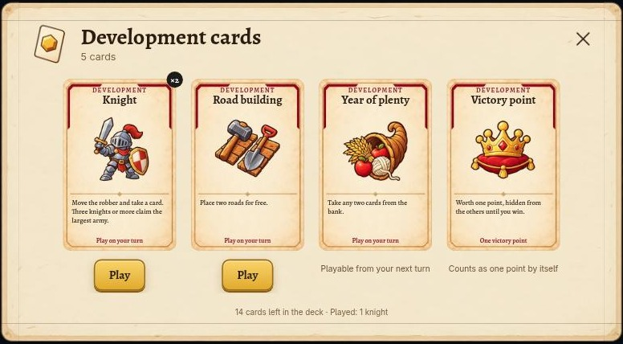
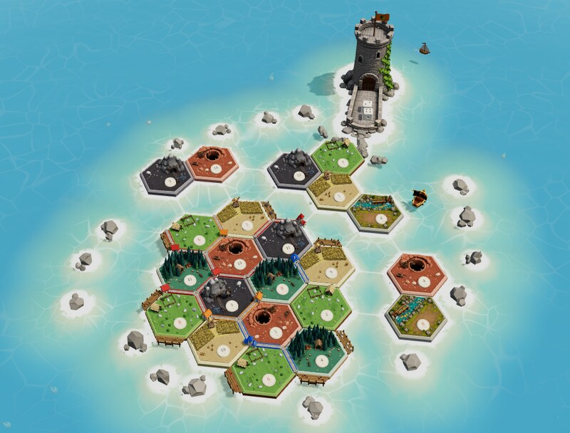
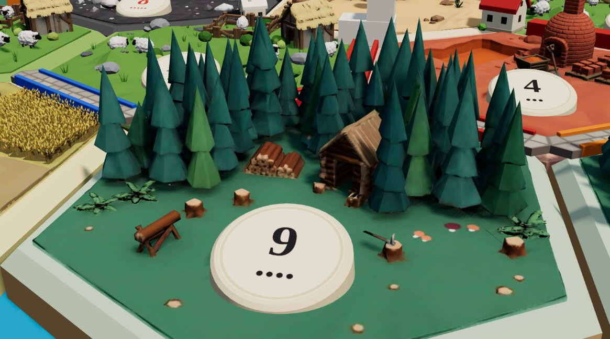
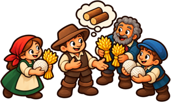
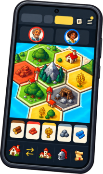
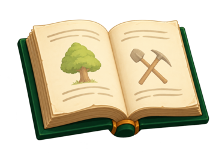
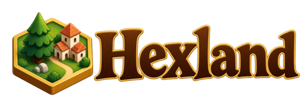

  

# What's new in Tilestead

Everything that has come to the island, newest first. Each date is the day it reached [tilestead.com](https://tilestead.com).

 

## 31 October 2026 · Cards up close

Your development cards now look like real cards, and the rules books of the expansions tell you what is different.

- **Development cards up close.** Every development card has a front of its own, with a picture and what the card does. Hover over a card in your hand to see it full size.
- **Play from a window.** Click any of your development cards to see them all. Each card has a Play button, or tells you why you cannot play it yet. In Cities & Knights, click your progress cards to open them in the same way.
- **See what you draw.** A card you buy or draw shows large in the middle of the island before it goes into your hand. The cards of the other settlers fly to them face down.
- **Know the base game?** The rules books of Cities & Knights and Seafarers now start with a chapter about only what is different from the base game, enough to start playing.
- **Tilestead's hex on the dice tower's flag.** The flag now shows the true colour of the settler whose turn it is, and it stays in view while the dice roll.
- After a roll the camera stays close to the dice tower, instead of jumping back out.

 

## 30 October 2026 · Set sail with Seafarers

Seafarers is here. Build ships, sail to new islands for extra points, take what you like from gold fields and keep away from the pirate.

- **Ships.** Build them from wood and wool and sail them along the coast and across the sea. Ships count towards the longest trade route, just like roads.
- **New islands.** The first settlement you build on each island beyond your home island is worth 2 extra points.
- **Gold fields.** When a gold field's number is rolled, you choose which resources it gives you.
- **The pirate.** A seven or a knight can move the pirate instead of the robber. He robs settlers whose ships lie beside him, and nobody can build or move a ship next to him.
- **Seafarers with Cities & Knights.** Play the sea on its own or together with Cities & Knights: knights travel along your ships and chase the pirate away.
- The computer settlers sail along, and Seafarers has its own rules book and tips.

Also in this release:

- **A new dice tower.** Its door swings open and the dice roll out down the gutter, landing somewhere different every throw. The flag on top flies in the colour of the settler whose turn it is.
- **Straight into your game.** A link to a game now opens that game, behind a loading screen until the island is complete, and the camera glides in to it.
- **Smoother on every device.** The island draws fewer frames when little is moving, which keeps slower devices smooth and saves battery.
- Choose for me now also gives back progress cards over the limit and finds a spot for a displaced knight, and notifications work in Chrome Beta, Dev and Canary too.

 

## 26 October 2026 · The tiles come alive

The island got a lot busier.

- **The fields** have a half-timbered windmill whose sails never stop turning, chunky wheat in rows that waves in the wind, and a cart, stooks, a bale and a basket on the stubble.
- **The hills** now hold the clay mine, with a crane, a basket that goes down into the dark and a pallet of bricks beside the shaft.
- **The mountains** have a tunnel, and every now and then a cart full of ore rolls in and comes back out.
- **The forest's firs** sway in the same wind as the wheat.
- **When the robber lands**, dust puffs up around his feet, and on the pasture the sheep run into their hut until he is gone.

 

## 25 October 2026 · Name your price

Need a card but not sure what the others want for it? Now you can ask.

- **Ask for a price.** Tick the kinds of cards you can spare, and everyone answers with a price of their own. The answers are listed cheapest first; take the best one.
- **The computer settlers bid too**, and when they make a counter-offer they keep the card you asked for and only change the price.
- A counter-offer you cannot pay is marked, so you know before you click.
- Everyone who answered an offer now sees how it ended.
- Lighter knights, merchants, forests and mines, so games load faster.

 

## 24 October 2026 · Play on your phone

Tilestead now has a screen made for phones: build, trade and lead your knights with one thumb.

- **A phone screen of its own**, with the settlers along the top, the island in the middle and your cards with the Build, Trade and Chronicle tabs along the bottom.
- **Cities & Knights on your phone**, with the barbarians always in sight, tabs for your cities and your knights, and progress cards you play by tapping the island.
- Your games and the waiting room fit a phone too.
- In fullscreen the screen stays on, and the game uses the whole screen up to the camera.
- **Notifications are on by default.** Tilestead asks once on each device, so you never miss your turn.
- **Tips that fit your game**: a city you can build, a knight to play, the robber on your tile or a hand a seven would halve.
- Every computer settler gets a face of its own and a name to match.
- Change your portrait and it changes in every game you sit in.

 

## 22 October 2026 · Smarter settlers and a book of rules

- **Game manuals are here.** Every game has its own illustrated rules book whose pages turn as you read, with the numbers of the game you are playing.
- **Smarter computer settlers.** They plan their trades and builds better, and easy, normal and hard each play their own way. When a slow game plays for someone who is away, it plays as well as it can.
- **A fresh coat of parchment.** Settings, Since you were away and every other window now sit on parchment.
- Tips stay up long enough to read, never repeat, and you can page back through them.
- Choices wait for you instead of slipping away, also when another settler's card asks something of you.
- The welcome screen shows the latest news from Tilestead.
- Many small fixes to the rules: Year of Plenty gives only resources, a road that starts at another settler's building counts, and the barbarians attack before the roll's cards are handed out.

 

## 20 October 2026 · Hello, Tilestead

Hexland is now **Tilestead**, with a new logo, and the island is open to everyone at [tilestead.com](https://tilestead.com).

- **A live welcome.** The welcome screen shows a live island where a pretend game is being played.
- **Log in** with Google or with a code sent to your email address, and choose a name and a portrait, or upload your own photo.
- **Choose your game**: the Base Game or Cities & Knights, live or slow.
- **The waiting room**, with the room code, an invitation link and your colour. The host sets the points to win, a random seat order, a friendly robber, the discard limit and how many pieces are in the box.
- **The turn on parchment.** Every step of a turn has a picture and clear words, and the chronicle is grouped by turn with the newest on top, each line marked in its settler's colour.
- **New tiles** for the pasture, forest, hills, fields, desert and mountains, and a vulture that rests in the desert's dead tree between its flights.
- **Notifications.** The browser tells you when the game waits for you, also when Tilestead is closed.
- The settlers column shows who holds the merchant and which resource he trades.

 

## 17 October 2026 · Hexland opens for the family

The first release on its own server, two weeks after the first line of the game was written on 2 October. It was called Hexland then, and the family played it from day one.

- **The Base Game**, complete: roads, settlements and cities, development cards, the robber, harbours, the longest road and the largest army, and trading with offers and counter-offers.
- **Cities & Knights**, complete: commodities, city improvements and metropolises, city walls, knights, progress cards, the merchant, the aqueduct and the barbarians, who burn the cities they sack.
- **Live and slow games.** Slow games have deadlines, email you when it is your turn and play for you when you miss one.
- **Computer settlers** at three levels.
- **A living 3D island** with a dice tower in the sea, boats, fish and a barbarian ship.
- **The board builder**: generate a fair island or shape one by hand.
- **Since you were away** and **What changed**, so you can catch up after a break.
- A rematch from the end screen, your seat on any device, and the whole game in English and Dutch.

 
