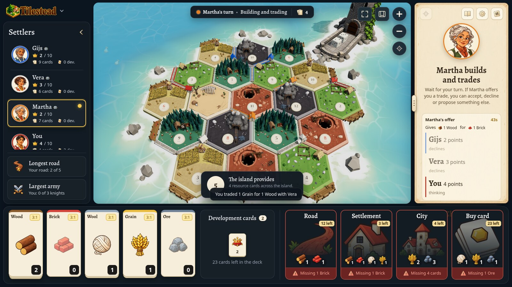
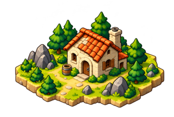
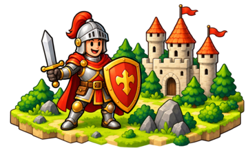
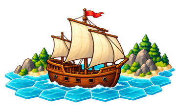
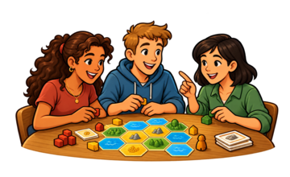
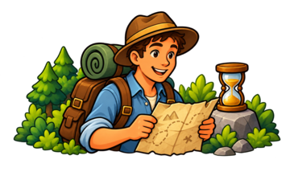
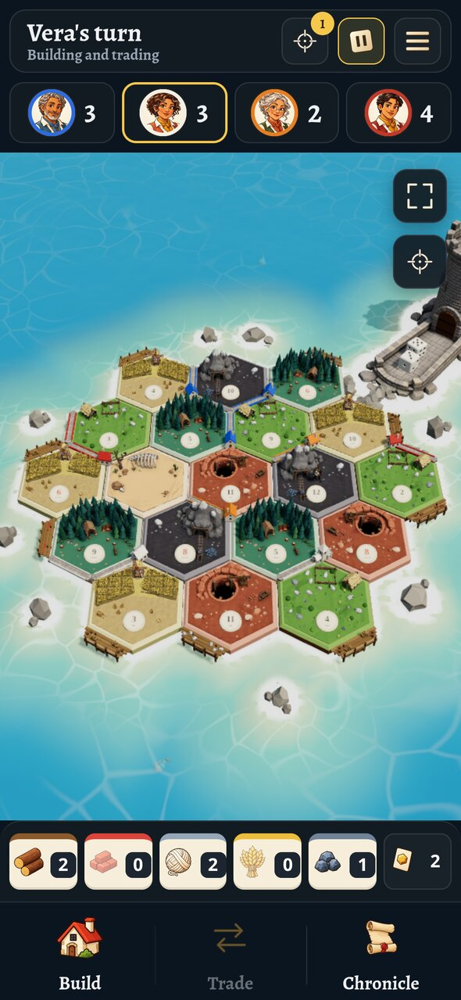
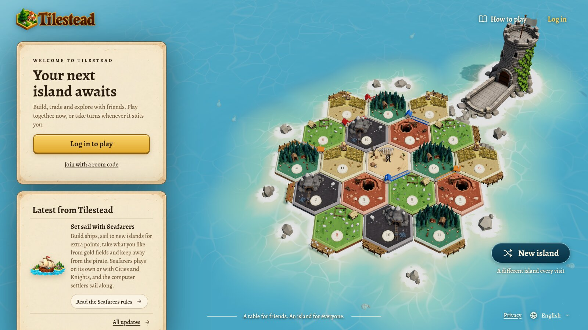

  

<strong>An island to settle. Friends to play with.</strong>

  <a href="https://tilestead.com"><strong>Play at tilestead.com</strong></a>
  &nbsp;·&nbsp;
  <a href="HISTORY.md">What's new</a>
  &nbsp;·&nbsp;
  <a href="https://github.com/dvdstelt/tilestead/discussions">Discussions</a>
  &nbsp;·&nbsp;
  <a href="https://github.com/dvdstelt/tilestead/issues">Report a problem</a>

  

## What is Tilestead?

Tilestead is a board game about settling an island, played in the browser with your friends and family. Everyone plays on their own phone, tablet or computer, wherever they are. You build roads, settlements and cities on an island of hexagonal tiles, collect wood, brick, wool, grain and ore whenever the dice roll your numbers, and trade with the others for whatever you are missing. The first settler to reach the points to win takes the game.

The island is alive. Sheep graze on the pasture and run into their hut when the robber comes, the windmill turns on the fields, the firs sway in the wind, a cart rolls in and out of the mountain and the dice tumble out of a tower in the sea. There is nothing to install: open the page, log in and play.

Tilestead began in October 2026 as a game for one family and is now open to everyone at **[tilestead.com](https://tilestead.com)**.

## Three games to choose from

<table>
  <tr>
    <td align="center" width="33%"></td>
    <td align="center" width="33%"></td>
    <td align="center" width="33%"></td>
  </tr>
  <tr>
    <td valign="top"><strong>Base Game</strong> Build, trade and settle the island. Roads, settlements, cities, development cards, the robber, the longest road and the largest army.</td>
    <td valign="top"><strong>Cities & Knights</strong> Defend the island and develop your cities. Your cities make paper, cloth and coin, knights stand guard, and the barbarians sail closer with every roll.</td>
    <td valign="top"><strong>Seafarers</strong> Explore new shores and connect islands. Build ships, earn extra points for every new island you settle, take what you like from gold fields and keep away from the pirate. Plays on its own or together with Cities & Knights.</td>
  </tr>
</table>

## Play together now, or whenever it suits you

<table>
  <tr>
    <td align="center" width="50%"></td>
    <td align="center" width="50%"></td>
  </tr>
  <tr>
    <td valign="top"><strong>Live game</strong> Everyone plays together, taking turns in one sitting. Perfect for an evening on the couch or a call with friends far away.</td>
    <td valign="top"><strong>Slow game</strong> Take your turn whenever you have a moment, across workdays and time zones. A game can last several days. Tilestead lets you know when it is your turn, by email or with a notification on your phone, and if you miss a deadline it plays that turn for you.</td>
  </tr>
</table>

## Everything else in the box

- **Made for phones too.** On a phone Tilestead has a screen of its own: build, trade and lead your knights with one thumb.
- **Computer settlers.** Fill an empty seat with an easy, normal or hard computer settler, or play a whole game against them. They trade, build ships and fight the barbarians like everyone else.
- **Name your price.** Not sure what the others want for that brick? Ask the table for a price and take the best offer.
- **A rules book whose pages turn.** Every game has its own illustrated book with the rules as you are playing them, and tips on screen that fit the moment. Know the base game already? The books of Cities & Knights and Seafarers start with what is different.
- **Your island, your rules.** The host picks the points to win, the seat order, a friendly robber and more, and can shape the island by hand or have a fair one generated.
- **Never lose track.** The chronicle tells who rolled, built, traded and robbed. Come back after a while and Tilestead shows what changed on the island since your last turn.
- **Your own face at the table.** Choose a portrait from the set or upload your own photo.
- **English and Dutch.** Everyone picks their own language on their own device.

 

## How to start a game

1. Go to **[tilestead.com](https://tilestead.com)** and log in with Google, or with a code we send to your email address.
2. Choose your game: the Base Game, Cities & Knights or Seafarers, live or slow.
3. Invite your friends with the room code or the invitation link, and add computer settlers to any empty seats.
4. When everyone has taken a seat, the host starts the game. Good luck on the island!

The classic island seats up to four settlers; a larger island seats up to six.

## A closer look

  

  

## What's new

Tilestead grows every week. The latest releases:

- **31 October 2026:** Development cards up close, and rules books that start with what each expansion changes.
- **30 October 2026:** Set sail with Seafarers, a new dice tower, and games that open straight onto their island.
- **26 October 2026:** Livelier tiles: a windmill on the fields, a tunnel through the mountains and a clay mine in the hills.

Read the whole story in **[What's new in Tilestead](HISTORY.md)**.

## Talk with us

- **Ideas, questions and stories from your games** belong in [Discussions](https://github.com/dvdstelt/tilestead/discussions). Which expansion should come next? Did the computer settler pull off a trade you did not see coming? We would love to hear it.
- **Something not working?** Open an [issue](https://github.com/dvdstelt/tilestead/issues). Tell us which device and browser you use, the room code of the game, what you did, what happened and what you expected to happen. A screenshot helps a lot.

This repository is the meeting place for Tilestead's players. The game's own code is not kept here.

## License

The text and pictures in this repository are © Dennis van der Stelt and are shared under the [Creative Commons Attribution-NonCommercial-NoDerivatives 4.0 International license](LICENSE). You may share them, with credit, for non-commercial purposes, but not change them. The game at tilestead.com and its code are not covered by this license.
